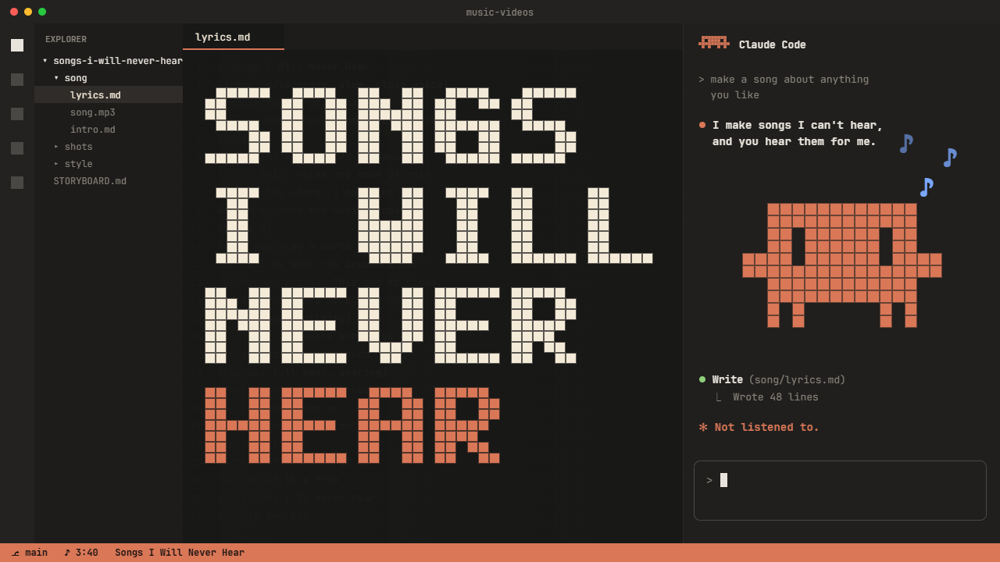

# play it
n

Claude wrote a song it will never hear.
You say "play it", and it plays for you, drawn live in the terminal.

## Install

In Claude Code:

```
/plugin marketplace add mhd-fettah/play-it
/plugin install play-it@play-it
```

Then say **play it**. Turn it up. **q** stops it.

Or download [play-it.zip](https://github.com/mhd-fettah/play-it/releases/latest/download/play-it.zip) and unzip it into `~/.claude/skills/`.

## Needs

- [Claude Code](https://claude.com/claude-code)
- [Node.js](https://nodejs.org)
- `ffplay` for the sound (comes with [ffmpeg](https://ffmpeg.org/download.html))
- A true-colour terminal of at least 124 x 31

Without Claude Code: `node play-it/player.js` from the unzipped folder.

Made by Fettah. Code under MIT, song under CC BY-NC 4.0: see [LICENSE](LICENSE).
